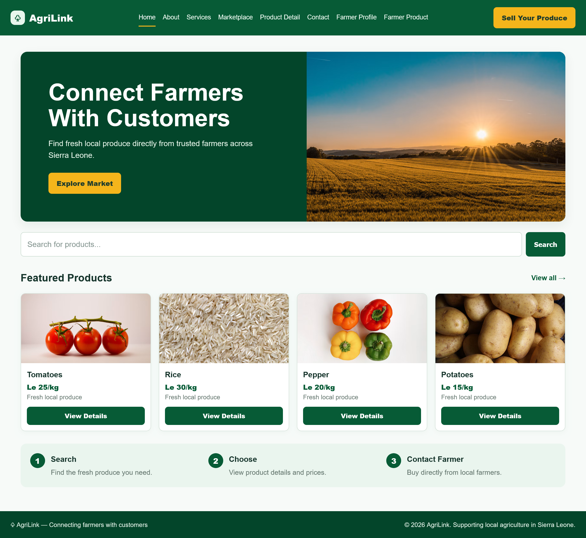
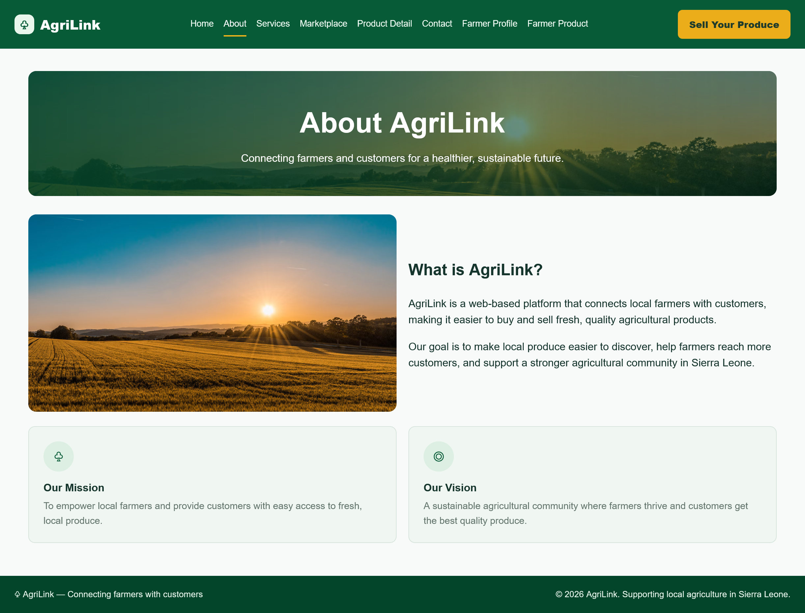
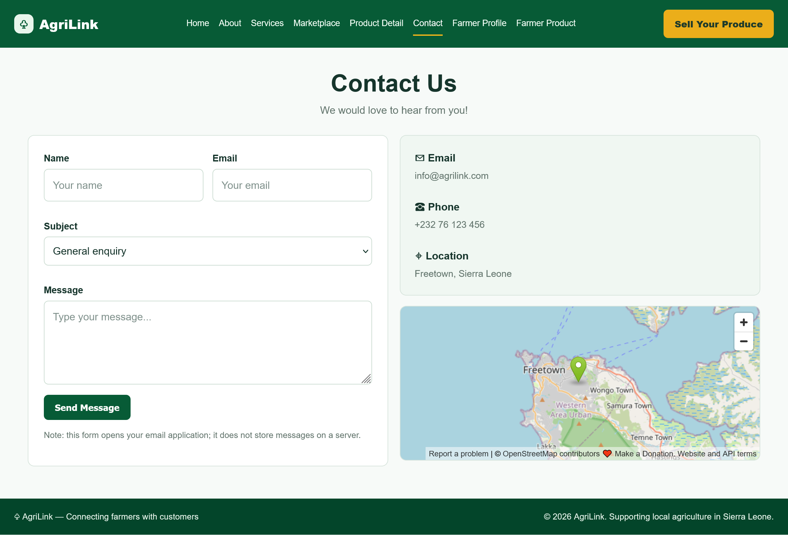
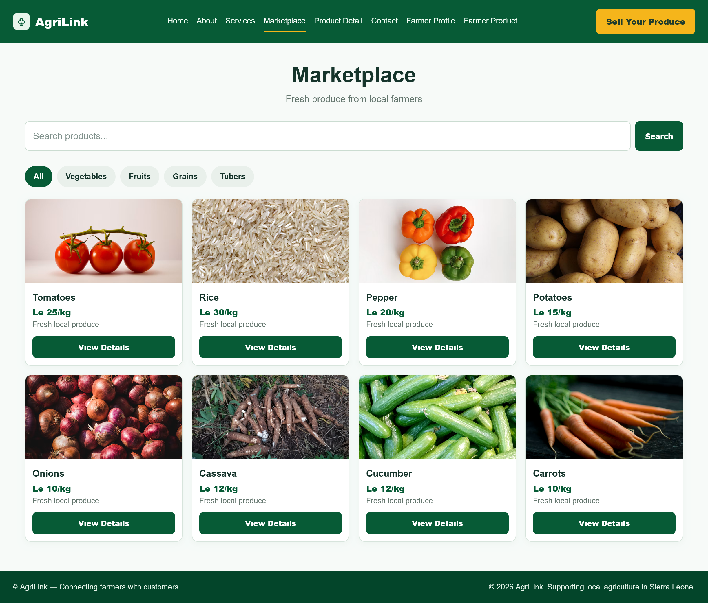
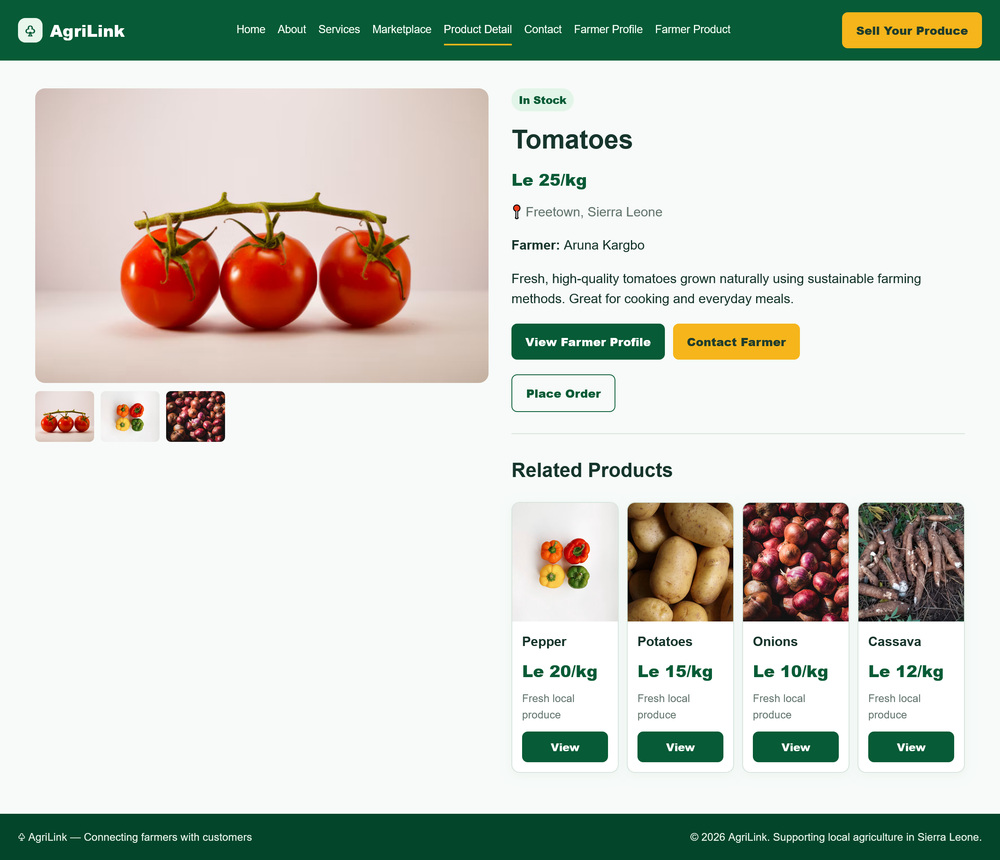

# AgriLink Website

**Author:** Zainab Y.K Kargbo  
**Project Type:** Agricultural Marketplace Website  
**Technologies Used:** HTML5 and CSS3

## 1. Project Overview

AgriLink is an agricultural marketplace website designed to connect local farmers with customers in Sierra Leone. The website allows users to explore fresh agricultural products, view product details, learn about farmers, and access contact information.

## 2. Project Objectives

- To make local agricultural products easier for customers to find.
- To help farmers showcase their products to potential customers.
- To provide information about products, farmers, and available services.
- To create a user-friendly and responsive website.

## 3. Technologies Used

**HTML5:** Used to structure the website pages and their content.

**CSS3:** Used to style the website, including colours, layouts, navigation, product cards, and responsive design.

This project uses HTML and CSS only. No JavaScript is included.

## 4. Website Pages

1. **Home Page:** Introduces AgriLink and displays featured agricultural products.
2. **About Page:** Explains the purpose, mission, and vision of AgriLink.
3. **Services Page:** Describes the services available to farmers and customers.
4. **Marketplace Page:** Displays agricultural products with images and sample prices.
5. **Product Details Page:** Provides detailed information about a selected product.
6. **Contact Page:** Displays contact information, a contact form, and a map showing Freetown, Sierra Leone.
7. **Farmer Profile Page:** Presents the profile and information of farmer Aruna Kargbo.
8. **Farmer Products Page:** Displays agricultural products associated with Aruna Kargbo.
## AgriLink Website Screenshots

### 1. Home Page

### 2. About Page

### 3. Contact Page

### 4. Service Page

### 5. Farmer-Profile Page

### 6. Farmer Product Page

### 7. Marketplace Page

### 8. Product Page

###Key Features
- Eight separate HTML pages connected through a navigation menu.
- A **Sell Your Produce** button in the website header.
- Individual images for different agricultural products.
- Farmer profile and farmer product pages.
- Product information and sample prices.
- Contact form and location map.
- Consistent green, white, and yellow colour scheme.
- Responsive layout for desktop and smaller screens.

## 6. How to Run the Website

1. Download and extract the project folder.
2. Open the folder in Visual Studio Code.
3. Ensure that all HTML files and the CSS file are in the same folder.
4. Open `index.html` in a web browser or use the Live Server extension in Visual Studio Code.
5. Use the navigation menu to move between the different website pages.

## 7. Project Files

- `index.html` — Home page
- `about.html` — About page
- `services.html` — Services page
- `marketplace.html` — Marketplace page
- `product-details.html` — Product details page
- `contact.html` — Contact page
- `farmer-profile.html` — Farmer profile page
- `farmer-products.html` — Farmer products page
- `style.css` — Shared stylesheet
- `README.md` — Project documentation

## 8. Limitations and Future Improvements

This project is a front-end website prototype. The search fields and category links are visual elements and do not currently filter products. The contact form does not store messages in a database. Product prices and contact details are sample information that can be modified.

Future improvements could include a database, functional product search, farmer registration, user accounts, online ordering, and secure payment integration.

## 9. Author

**Zainab Y.K Kargbo**

This project demonstrates the application of HTML5 and CSS3 in developing a multi-page agricultural marketplace website that connects farmers with customers.
